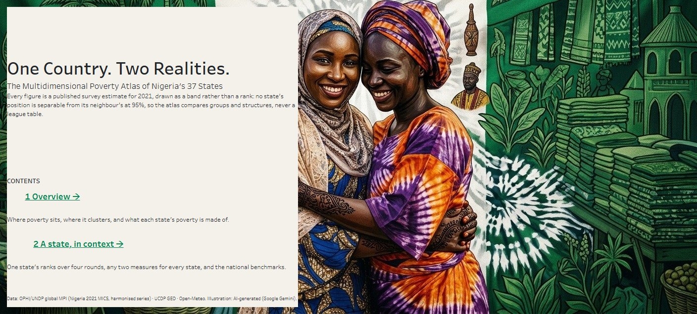
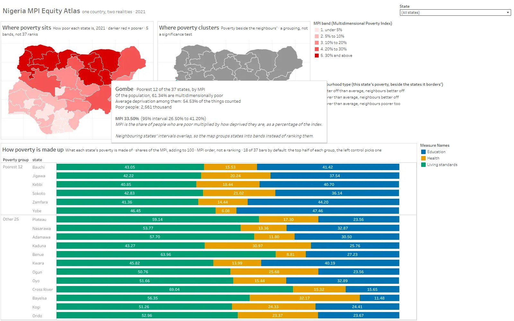
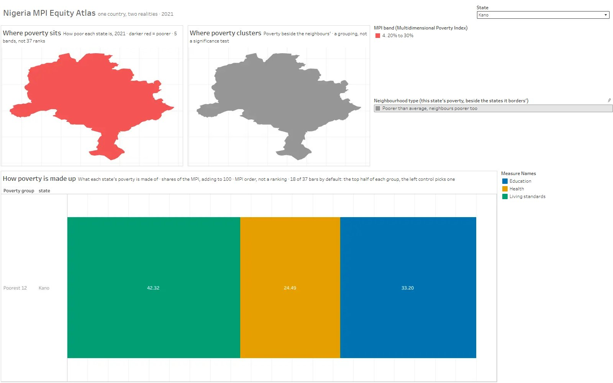
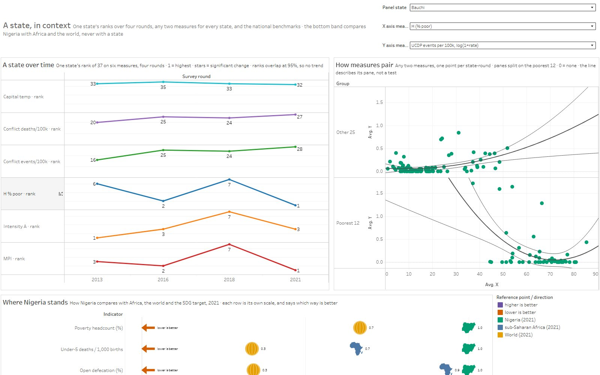
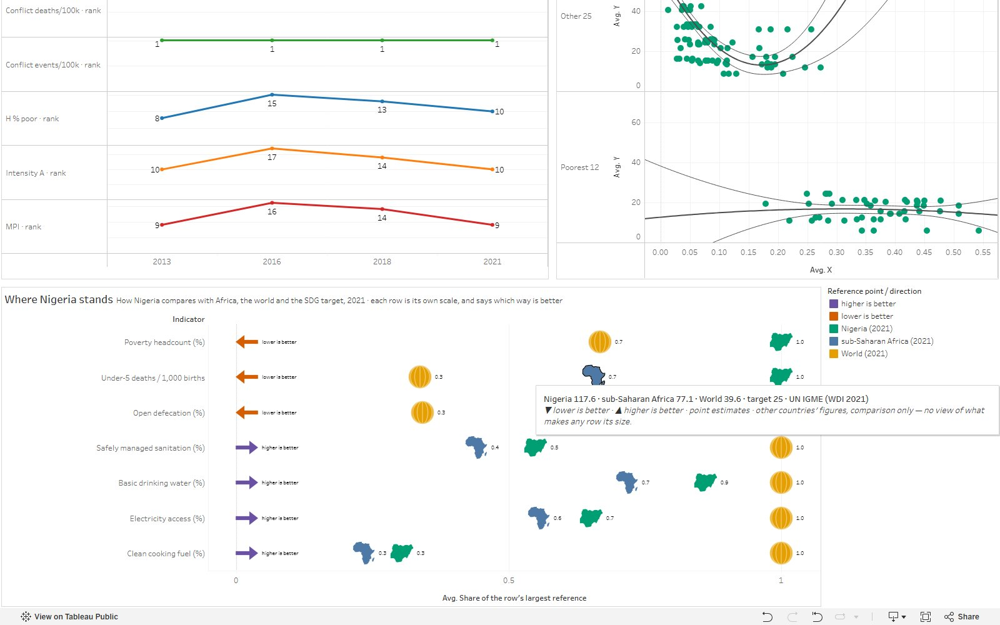

# Nigeria Equity Atlas (Tableau)

An interactive atlas of Nigeria's **Multidimensional Poverty Index (MPI)** at state
level — 36 states plus the Federal Capital Territory — disaggregated into its three
dimensions (health, education, living standards), with UCDP conflict and Open-Meteo
climate layers, plus a four-round poverty trend panel.

The deliverable is a Tableau Public viz. The pipeline that builds it is a set of
numbered, independently runnable Python scripts.

```
MICS 2021 baseline · 37 admin-1 units · poverty + conflict + climate + 4 survey rounds
```

## See it live

**[Open the atlas on Tableau Public →](https://public.tableau.com/app/profile/jerry.bannister/viz/Nigeria-MPI-Equity-Atlas)**

[](docs/demo/atlas_demo.mp4)

▶ **[Watch the 2:41 demo](docs/demo/atlas_demo.mp4)**: every click, hover and filter,
recorded on the live viz. Music: *Motherland* by Sound Sultan.

### What you can click

| Where | Control | What it does |
|---|---|---|
| **Start here** (cover) | **1 Overview →** / **2 A state, in context →** | open the two dashboards |
| **Overview** | **State** drop-down | filters all three panes to one state; `(All states)` restores the default |
| | hover a state on the poverty map | MPI with its 95% interval, the headcount, average deprivation, number of poor people |
| | hover a state on the cluster map | its neighbourhood type, and its poverty beside its neighbours' average |
| | click a state, or a legend entry | highlights it; click again to clear |
| | hover a bar segment | that state's share of poverty from health, education or living standards |
| **A state, in context** | **Panel state** drop-down | the state shown on the time panel (rank of 37, six measures, four rounds) |
| | **X axis / Y axis** drop-downs | any two of 24 measures on the pairs board, one quadratic fit and 95% band per pane |
| | hover a point | names the state; on the benchmarks band, the values and the direction key |

The three reference tabs (what the words mean, the list of basic needs, how it was
made) are published too:
[words](https://public.tableau.com/views/Nigeria-MPI-Equity-Atlas/Whatthewordsmean) ·
[needs](https://public.tableau.com/views/Nigeria-MPI-Equity-Atlas/Thelistofbasicneeds) ·
[method](https://public.tableau.com/views/Nigeria-MPI-Equity-Atlas/Howwedidit).

| | |
|---|---|
|  |  |
| *Overview: hover a state* | *Overview: the State control set to Kano* |
|  |  |
| *A state, in context: time panel and pairs board* | *Where Nigeria stands: national benchmarks* |

## Quick start

```powershell
# from the repository root
.\scripts\run_all.ps1
```

Or stage by stage:

```powershell
foreach ($s in '00_validate_reference','01_acquire_mpi','02_acquire_conflict',
               '03_acquire_climate','04_merge','05_preview','06_build_twb') {
  & C:\Users\TOSHIBA\ds-general\python.exe "scripts\$s.py"
}
```

Requires Python 3.12 with `scipy`, `matplotlib`, `openpyxl` and `shapely`:

```powershell
uv pip install --python C:\Users\TOSHIBA\ds-general\python.exe -r requirements.txt
```

`data/raw/` is gitignored and fully re-downloadable, so a clean checkout re-fetches
every source. Nothing in the pipeline needs a registration, an API key, or a login.

## Outputs

| Path | What it is |
|---|---|
| `tableau/Nigeria-MPI-Equity-Atlas.twbx` | the workbook to publish, with data packaged inside |
| `data/processed/mpi_atlas_2021.csv` | 37 rows, one per state, the 2021 baseline |
| `data/processed/mpi_trends_panel.csv` | 148 rows, 37 states × 4 survey rounds |
| `data/processed/atlas_vintages.csv` | per-round scale anchors and summary statistics |
| `docs/preview/*.png` | the five spec visuals, rendered as a QA gate |
| `docs/normalisation.md` | exactly how every derived index is defined and scaled |
| `docs/data_quality.md` | the caveats a published claim has to carry |

## Documentation

- **[docs/WORKFLOW.md](docs/WORKFLOW.md)** — how the pipeline fits together, how to
  extend it, and the conventions each stage follows.
- **[docs/HANDOFF.md](docs/HANDOFF.md)** — state of the project, decisions taken,
  what is verified versus assumed, and the traps already paid for. **Read this first
  when picking this up cold.**
- **[docs/PUBLISH.md](docs/PUBLISH.md)** — republishing to Tableau Public after a
  rebuild (File → Save to Tableau Public, same name), and the checks to run on the
  live viz.
- **[docs/normalisation.md](docs/normalisation.md)** / **[docs/data_quality.md](docs/data_quality.md)**
  — metric definitions and caveats. Both are required reading before quoting a number.

## Three things worth knowing before using this

1. **No conflict–poverty association is detectable, and this design could not
   detect a moderate one.** Spearman rho runs +0.34, −0.20, +0.10, −0.06 across the
   four survey rounds; at n = 37 the power is 0.75 at rho = 0.4. Say "no detectable
   association at |rho| ≲ 0.4", never "not associated". Also, the conflict variable
   undercounts where poverty is highest: five of the poorest 12 states record no UCDP
   event in 2021. Never quote a single round.
2. **Climate overlaps with poverty; it is not shown to drive it.** Baseline
   (1991–2020) precipitation correlates with MPI at rho = −0.80, but precipitation
   tracks latitude (−0.90), and latitude predicts MPI better (+0.82). That is consistent
   with a development gradient, not identified as a climate effect.
3. **Conflict data is UCDP, not ACLED.** ACLED was unobtainable in this environment.
   Event definitions differ, so magnitudes are not comparable to an ACLED figure.

## Sources and licences

| Layer | Source | Licence |
|---|---|---|
| Poverty | OPHI + UNDP Global MPI | CC0 / CC BY |
| Conflict | UCDP Georeferenced Event Dataset | CC BY-IGO |
| Climate | Open-Meteo Archive API | free, keyless |
| Boundaries | geoBoundaries ADM1 | CC BY 4.0 |
| Capitals | GeoNames `cities5000` | CC BY 4.0 |

Exact URLs, SHA-256 digests and fetch dates are recorded in `data/raw/_provenance.csv`
on every run.